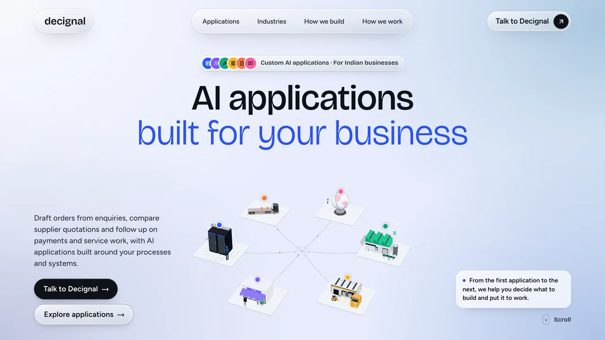

### Latest: [decignal.com](https://www.decignal.com)

A 3D scroll story built in React Three Fiber, tuned to stay smooth on mid-range phones. Click to scroll it yourself.

### Play

  
  

### What I work with

GLSL · GSAP · Lenis · React Three Fiber

### Also building

- **[Nopload](https://github.com/Singhaarav059/nopload)**: PDF toolkit that runs entirely in your browser, offline, no uploads
- **[KrishiSahayak](https://github.com/Singhaarav059/krishisahayak)**: multilingual plant-disease detection for Indian farmers
- **[FittiFi](https://github.com/Singhaarav059/fittifi-1)**: AI virtual try-on stylist

<picture>
  <source media="(prefers-color-scheme: dark)" srcset="https://raw.githubusercontent.com/Singhaarav059/Singhaarav059/output/snake-dark.svg" />
  
</picture>
